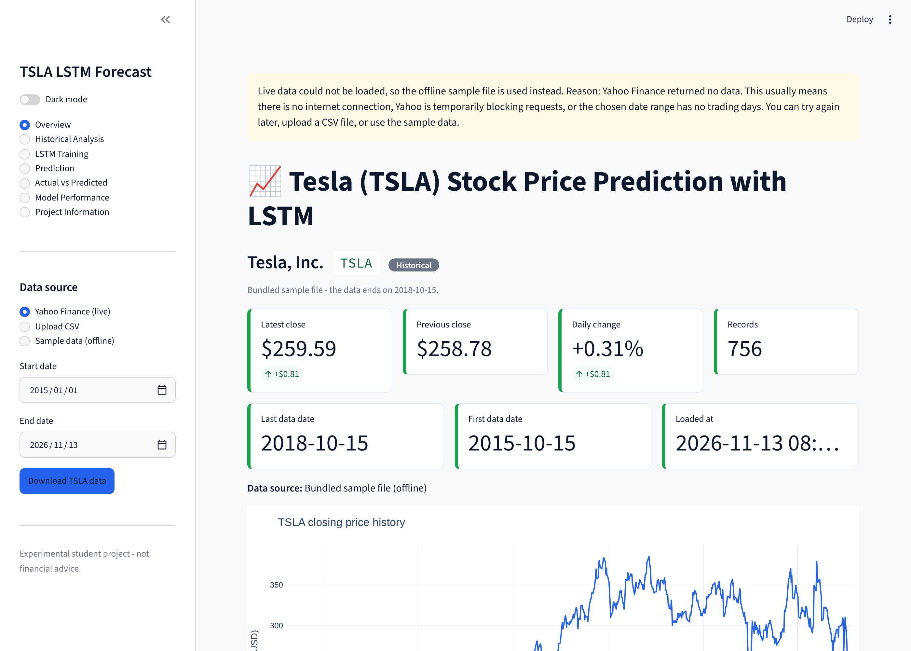
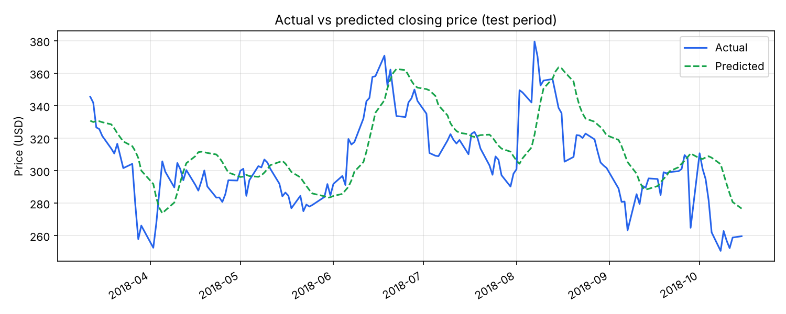
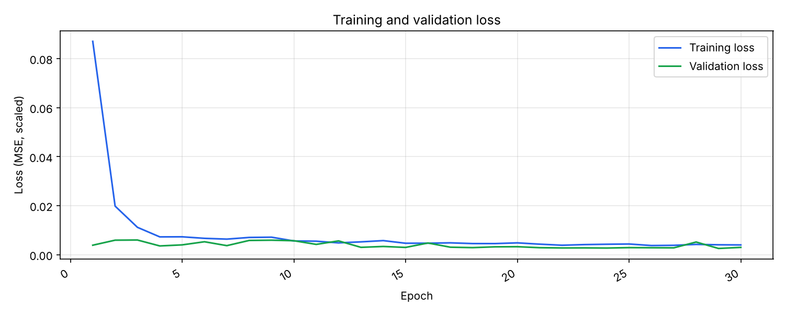

# Tesla (TSLA) Stock Price Prediction using LSTM

An end-to-end machine-learning web app that downloads Tesla stock prices, trains an
**LSTM neural network**, measures its errors honestly, and forecasts the next 1, 5 and 7 trading days
in an interactive Streamlit dashboard.

> **Experimental project - not financial advice.** Predictions are estimates from a student model that sees
> only past prices and volume. Do not use them to buy or sell shares.



---

## 1. Project description

The app does everything in one place: it **collects** real data (Yahoo Finance, CSV upload, or a bundled sample),
**cleans** it, **trains** an LSTM, **evaluates** it on data the model never saw, **forecasts** future prices
and **shows** all of it in seven dashboard pages. Nothing is hard-coded: every price, chart and metric comes from
the data and the trained model.

## 2. Problem statement

Stock prices form a *time series* - today's price depends on the recent past. Ordinary models treat each day
separately and ignore order. The question this project asks:

> *Given the last 60 trading days of Tesla's prices and volume, how well can an LSTM predict the next day's
> closing price - and how far ahead can it be trusted?*

## 3. Objectives

1. Collect real TSLA data (Yahoo Finance via `yfinance`, with CSV-upload and sample-file fallbacks).
2. Clean and prepare the data **without data leakage**.
3. Build, train and save an LSTM with TensorFlow/Keras.
4. Evaluate with MAE, MSE and RMSE computed from real predictions, and compare against a simple baseline.
5. Forecast the next day, 5 days and 7 days and clearly separate history from estimates.
6. Present everything in a clean dashboard that runs on Streamlit Community Cloud or Google Colab.

## 4. Dataset source

| Source | When it is used |
|---|---|
| **Yahoo Finance** via the [`yfinance`](https://pypi.org/project/yfinance/) library, symbol `TSLA` | Default. You choose the date range in the sidebar. |
| **CSV upload** | If the internet or Yahoo is unavailable. Needs columns Date, Open, High, Low, Close, Volume. |
| **`data/sample_data.csv`** | Offline fallback: real daily TSLA prices, **2015-10-15 to 2018-10-15 (756 trading days)**, taken from the public [Plotly datasets repository](https://github.com/plotly/datasets) (`tesla-stock-price.csv`). |

## 5. Dataset description

| Column | Meaning |
|---|---|
| Date | Trading day |
| Open / Close | First / last traded price of the day (USD) |
| High / Low | Highest / lowest price of the day (USD) |
| Adj Close | Close adjusted for splits and dividends (Yahoo only; shown for reference, not used by the model) |
| Volume | Number of shares traded |

The model uses **Open, High, Low, Close, Volume** as inputs and predicts the next day's **Close**.
The app labels the data **Historical**, **Delayed** or **Current** depending on how recent the last record is.

## 6. Technologies used

Python - Pandas & NumPy (data) - TensorFlow/Keras (LSTM) - Scikit-learn (MinMaxScaler, metrics) -
yfinance (data) - Plotly & Matplotlib (charts) - Streamlit (web app).

## 7. System architecture

```
Yahoo Finance / CSV upload / sample file
              |
      src/data_collection.py   -> validate columns, dates, errors
              |
      src/preprocessing.py     -> clean, 80/20 chronological split, scale, 60-day windows
              |
      src/lstm_model.py + src/training.py -> build, train, save model + scaler
              |
      src/prediction.py        -> test-set predictions, recursive 5/7-day forecast
      src/evaluation.py        -> MAE, MSE, RMSE, baseline, observations
              |
      utils/charts.py + app.py -> Plotly charts and the Streamlit dashboard
```

## 8. Data preprocessing

1. **Parse dates** to real datetimes (rows whose "date" is only a time such as `11:34` are removed).
2. **Convert numbers** (removes `$` and thousands commas).
3. **Drop duplicates** (identical rows and repeated dates).
4. **Sort** oldest to newest.
5. **Missing values** are forward-filled (uses yesterday, never tomorrow); rows still incomplete are dropped.
6. **Remove impossible values** (zero/negative prices, negative volume).
7. **Chronological split:** the first **80%** of days train the model, the last **20%** test it. Nothing is shuffled between them.
8. **MinMaxScaler fitted on the training days only**, then applied to everything (no leakage).
9. **60-day windows:** each sample = 60 days x 5 features; its answer = the next day's Close.
10. **Inverse scaling:** predictions are converted back to dollars **before** any metric is calculated.

Automatic tests (`tests/`) check the no-leakage rules, e.g. that the scaler's min/max equal the training data's
and that no training target comes from the test period.

## 9. LSTM model architecture

```
Input (60 days x 5 features)
LSTM(50, return_sequences=True)
Dropout(0.2)
LSTM(50)
Dropout(0.2)
Dense(25, ReLU)
Dense(1)                      -> next-day Close (scaled)
```
Adam optimizer, MSE loss, batch size 32, up to 30 epochs (changeable in the UI), seed 42.
**Total trainable parameters: 32,701.**

**What is an LSTM?** *Long Short-Term Memory* is a neural network for sequences. It has a built-in memory controlled
by three "gates": a **forget gate** (drop old information), an **input gate** (store useful new information) and an
**output gate** (decide what to pass on). Repeating this over 60 days lets it summarise the recent trend.

## 10. Training methodology

- The last **20% of the training windows** form a *validation set* (still chronological); the model never trains on it.
- **EarlyStopping** watches validation loss (patience 10) and restores the best epoch.
- Training windows are shuffled each epoch (safe: each window is self-contained; the train/test split stays chronological).
- The model, scaler and metadata (loss history, metrics, dates) are saved to `models/saved_model/` and loaded automatically when the app starts.

## 11. Evaluation metrics

| Metric | Plain-language meaning |
|---|---|
| **MAE** | Average size of the mistakes, in dollars. Lower is better. |
| **MSE** | Average of the squared mistakes (dollars squared); big misses count a lot. |
| **RMSE** | Square root of MSE, so it is back in dollars; also punishes big misses. |

A simple **baseline** ("tomorrow's price = today's price") is evaluated the same way, because a useful model should beat it.

## 12. Results from the actual run

Run: bundled sample data, 756 records (2015-10-15 to 2018-10-15). Train period ends 2018-03-09; **test period
2018-03-12 to 2018-10-15 (152 trading days)**. Windows: 436 train / 108 validation / 152 test.
All 30 epochs ran; best epoch 29; final training loss 0.00397, validation loss 0.00297. The numbers below are
copied from `outputs/predictions/metrics.json`.

| Metric | LSTM | Baseline (tomorrow = today) |
|---|---|---|
| MAE | **$16.88** | $8.43 |
| MSE | **455.43** | 141.00 |
| RMSE | **$21.34** | $11.87 |

**Observations (honest reading):**

- On average the LSTM was off by **$16.88**, about **5.5%** of the average test price ($305.94).
- **The LSTM did not beat the simple baseline.** Repeating yesterday's price had roughly half the error. This is
  common for daily stock data, where prices change little from one day to the next.
- The model tended to **over-estimate**: on average $7.85 above the real price.
- It predicted the **direction** (up/down) correctly on only **49.7%** of test days - no better than a coin flip.
- In the *Actual vs Predicted* chart the predicted line **lags** the actual line: it follows trends after they happen
  rather than anticipating them.
- The 7-day forecast starts with a jump from the last close ($259.59) to about $273.77 and drifts up to $285.43. That
  jump reflects the model's upward bias, **not** a real signal. Treat the forecast as a demonstration of the method.

| Day | Date | Predicted close |
|---|---|---|
| 1 | 2018-10-16 | $273.77 |
| 2 | 2018-10-17 | $273.58 |
| 3 | 2018-10-18 | $274.83 |
| 4 | 2018-10-19 | $276.92 |
| 5 | 2018-10-22 | $279.56 |
| 6 | 2018-10-23 | $282.45 |
| 7 | 2018-10-24 | $285.43 |

**Two things to be open about**

1. **Which data these results use.** Yahoo Finance was not reachable from the environment where this project was
   built, so the run above used the bundled sample (ending 2018). When you run the app with internet access,
   it downloads current data, and you can retrain to get new results for your own report. Re-training on the same
   data with the same seed reproduces the numbers above exactly (verified from both the command line and the app).
2. **Settings were adjusted once.** The first run used a 10% validation split, patience 5 and no shuffling; early stopping
   then ended training at epoch 6 with the best epoch at 1 (barely trained; test RMSE $35.30). I changed the validation
   split to 20%, patience to 10 and shuffled the training windows, judging by the validation curves. That
   change was made after seeing results on this same data, so treat the test metrics as indicative, not a fully
   untouched estimate.

Saved charts are in `outputs/graphs/` (PNG and interactive HTML); dashboard screenshots in `outputs/screenshots/`.

| Actual vs predicted | Training / validation loss |
|---|---|
|  |  |

## 13. Project folder structure

```
tesla-stock-prediction/
├── app.py                  Streamlit dashboard (7 pages)
├── config.py               All settings in one place
├── requirements.txt
├── README.md
├── .streamlit/config.toml  Theme colours
├── data/sample_data.csv    Real TSLA sample (2015-2018)
├── models/saved_model/     lstm_model.keras, scaler.pkl, metadata.json
├── src/
│   ├── data_collection.py  Yahoo / CSV / sample loading + validation
│   ├── preprocessing.py    Cleaning, scaling, windows, split
│   ├── lstm_model.py       The Keras architecture
│   ├── training.py         Training, save/load, command-line runner
│   ├── prediction.py       Test predictions + recursive forecast
│   └── evaluation.py       MAE / MSE / RMSE, baseline, observations
├── utils/
│   ├── helpers.py          Errors, formatting, data-freshness label
│   └── charts.py           Plotly (app) and Matplotlib (saved) charts
├── tests/test_pipeline.py  22 automatic tests
└── outputs/
    ├── graphs/             6 required charts (PNG + HTML)
    ├── predictions/        test_predictions.csv, forecast_7_day.csv, metrics.json
    └── screenshots/        Dashboard screenshots
```

## 14. Installation

Python 3.10 - 3.12 is recommended (3.11 is a safe choice).

```bash
git clone https://github.com/<your-username>/tesla-stock-prediction.git
cd tesla-stock-prediction
python -m venv venv
source venv/bin/activate            # Windows: venv\Scripts\activate
pip install -r requirements.txt
```

## 15. Execution

```bash
streamlit run app.py                       # the dashboard (opens in your browser)
python -m src.training --source sample     # train from the command line (sample data)
python -m src.training --source yahoo --start 2015-01-01 --end 2025-12-31 --epochs 30
python -m src.training --source csv --csv path/to/tsla.csv
python -m unittest discover -s tests -v    # run the 22 automatic tests
```

In the app: sidebar -> choose the data source -> **LSTM Training** page -> *Train model* -> then open
**Prediction**, **Actual vs Predicted** and **Model Performance**. A saved model is loaded automatically next time.

**Error handling:** the app shows friendly messages (never a crash) for no internet / Yahoo failure (it falls back to
the sample file), missing or empty columns, empty or invalid CSVs, invalid date ranges, too few records for a 60-day
window, training errors and a missing or corrupted saved model.

## 16. Deployment

### GitHub upload
```bash
cd tesla-stock-prediction
git init
git add .
git commit -m "Tesla stock prediction with LSTM"
git branch -M main
git remote add origin https://github.com/<your-username>/tesla-stock-prediction.git
git push -u origin main
```
Create the empty repository on github.com first (no README). Keep `models/saved_model/` in the repo (about 0.4 MB)
so the deployed app starts with a trained model.

### Streamlit Community Cloud
1. Push the project to GitHub (above).
2. Go to <https://share.streamlit.io>, sign in with GitHub and click **Create app**.
3. Choose your repository, branch `main`, main file **`app.py`**.
4. Under **Advanced settings** choose **Python 3.11** (or 3.12).
5. Click **Deploy**. The first build installs TensorFlow, so allow a few minutes.

Streamlit Cloud has limited memory and CPU; training 30 epochs takes a few minutes there, but the saved model means
visitors can use Prediction and Performance immediately.

### Google Colab
```python
# Cell 1 - get the code (or upload the ZIP and unzip it)
!git clone https://github.com/<your-username>/tesla-stock-prediction.git
%cd tesla-stock-prediction
!pip install -q -r requirements.txt

# Cell 2 - train without the web page
!python -m src.training --source yahoo --start 2015-01-01 --epochs 30

# Cell 3 - (optional) run the dashboard through a tunnel
!pip install -q pyngrok
from pyngrok import ngrok
ngrok.set_auth_token("<your free ngrok token>")
!streamlit run app.py --server.port 8501 &>/dev/null &
print(ngrok.connect(8501))
```

### ZIP packaging
- **Windows:** right-click the `tesla-stock-prediction` folder -> *Send to* -> *Compressed (zipped) folder*.
- **macOS / Linux:** `zip -r tesla-stock-prediction.zip tesla-stock-prediction -x "*/__pycache__/*" "*/venv/*"`

## 17. Limitations

- Prices are driven by news, earnings, interest rates and human behaviour; the model sees only past prices and volume.
- One-day-ahead prediction often barely beats "tomorrow = today" - and in this run did not (see results).
- Recursive forecasts feed predictions back in, so errors can grow over 5-7 days; for future days Open/High/Low are
  assumed equal to the predicted Close and volume is held constant.
- Small data in the bundled sample (756 days, 436 training windows) limits what an LSTM can learn.
- One model with fixed settings; no wide hyper-parameter search or walk-forward validation.
- Forecast dates skip weekends but not stock-market holidays. Dashboard data tables stay light-coloured in dark mode.

## 18. Future enhancements

- Add technical indicators (moving averages, RSI) and news-sentiment features.
- Compare with GRU, Transformer and classical models (ARIMA); tune settings with walk-forward validation.
- Predict a range (confidence band) instead of a single number; predict returns instead of prices.
- Support more tickers and a user-chosen window length.
# Telsa-Stock-Prediction-

